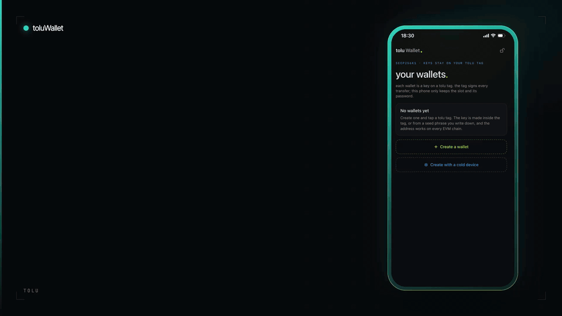
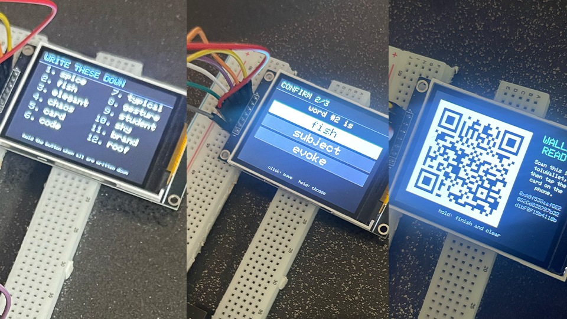

# toluWallet

*Open-source DIY cold crypto wallet. Don't buy the box that guards your keys:
build it, and read every line it runs.*



toluWallet is an EVM wallet whose private key lives inside a
**[toluTag](https://github.com/mwbpNFTechnology/toluTag)**, a passive NFC tag
carrying an NXP SE051 secure element. An iPhone app is the interface: it shows
balances, receives and sends like any wallet, but it never holds the key. The
tag signs every transfer.

For a wallet with a seed-phrase backup that never touches a phone, the
repository also holds **tolu_cold**: an offline ESP32 device you build from
three off-the-shelf modules, which makes the seed phrase and writes its key
straight onto the tag.

| Component | Platform | What it is | Parts |
|---|---|---|---|
| [`toluWallet`](toluWallet) | iOS 26, SwiftUI, CoreNFC | The wallet: balances by chain, receive, send, and three ways to create a key | An iPhone |
| [`tolu_cold`](tolu_cold) | ESP32 / ESP32-S3, Arduino | The offline key-ceremony device: seed phrase on its own screen, key onto the tag | Under $15 |
| [toluTag](https://github.com/mwbpNFTechnology/toluTag) | NXP SE051 over NFC | Where the key lives. A separate, open project: build one or request a dev kit | Under $4 |

The hardware is cheap on purpose: a toluTag can be produced for **under 4 USD**
in components and a tolu_cold for **under 15 USD**, so the whole setup, tag
plus key-ceremony device, comes to under 19 USD in parts.

There is no account, no server of ours and no update channel. The app has no
third-party dependencies; Keccak-256, secp256k1, RLP, transaction encoding,
BIP-39 and BIP-32 are implemented in this repository, in Swift for the app and
in C++ for the device, and tested against the same reference values.

---

## Why I built this

A hardware wallet is a promise: *this box keeps your key away from everything
else.* You cannot check that promise. You are asked to trust the company that
made the box, the firmware inside it that you cannot read, the shop that sold
it, and everyone who handled it before it reached your door.

One of the best-known makers in the business shows how much there is to trust.
None of what follows needed anyone to break the chip inside:

- **2020, the customer list.** Ledger's e-commerce database was stolen and
  later published: about 272,000 names, home addresses and phone numbers, and
  over a million email addresses.
  ([Decrypt](https://decrypt.co/52118/hacked-ledger-database-dumped-on-raidforums))
- **2021, the box in the post.** People on that list began receiving tampered
  Ledger devices by mail, shrink-wrapped, with a letter in the CEO's name
  telling them to switch to the "replacement". The aim was to get them to
  enter their recovery phrase.
  ([BleepingComputer](https://www.bleepingcomputer.com/news/cryptocurrency/criminals-are-mailing-altered-ledger-devices-to-steal-cryptocurrency/))
- **2023, the firmware.** Ledger announced Recover, an optional service in
  which the wallet's firmware sends encrypted shares of the seed phrase to
  three companies. For many owners it was the first time it was clear that a
  firmware update can make the device send key material out at all.
  ([The Block](https://www.theblock.co/post/230992/ledger-defends-crypto-wallet-recovery-tool))
- **2023, the software around it.** A phished former employee's account was
  used to publish a malicious version of Ledger's Connect Kit library. For a
  few hours the apps that loaded it carried a wallet drainer, and about
  $600,000 was taken from their users. The hardware itself was not breached.
  ([Ledger's incident report](https://www.ledger.com/blog/security-incident-report))

This is not about one company; it is simply the best-documented one. The lesson
is general. A sealed product from a known brand is a target: for whoever can
get between the factory and you, and for whoever can change what it runs. And
you, the owner, have no way to look inside.

So I stopped looking for a wallet I could trust and built one that asks for as
little trust as possible:

- **Nothing to intercept.** There is no "wallet" in a box. The device is a
  generic ESP32 board, an NFC module and a display, bought wherever you like
  for under 15 USD. Nobody upstream knows they will ever hold a key.
- **Nothing you can't read.** The app, the firmware and all of the cryptography
  are in this repository. You compile and flash them yourself.
- **Nothing in between.** No account, no vendor server, no forced updates. The
  app talks to public blockchain nodes; the device talks to nobody.
- **The key stays in a secure element.** It is generated in, or written once
  into, a toluTag and cannot be read back out. Every signature is made by the
  chip, inside an encrypted session that only your iPhone can open.

What you are still trusting is listed, plainly, [further down](#what-you-still-trust).

---

## A wallet on a toluTag

A [toluTag](https://github.com/mwbpNFTechnology/toluTag) is an open NFC tag
around an SE051 secure element that can hold a secp256k1 key and sign with it.
toluWallet is the iOS interface built on top: it turns that tag into a wallet
you use like any other.

**Portfolio**

- Balances for every chain, sorted by value in US dollars; chains with nothing
  on them are greyed out.
- Open a chain to see its tokens (ERC-20), NFT collections (ERC-721 and
  ERC-1155, view only) and the transaction history.
- Nine networks out of the box: Ethereum, Optimism, BNB Smart Chain, Polygon,
  Base, Arbitrum One, Avalanche C-Chain, and the Sepolia and Base Sepolia
  testnets. One address works on all of them.

**Receive**

- The wallet's address as text and as a QR code.

**Send**

- The native coin or any ERC-20 token, with the fee estimated before you
  confirm (EIP-1559 where the chain supports it, including the L1 data fee on
  OP-stack chains).
- The app builds the transaction, you tap the tag, the chip signs it, and the
  app broadcasts it and waits for it to settle.

**Locked by Face ID**

- The phone stores only where each wallet lives on the tag (two object ids),
  in the Keychain behind Face ID. It locks itself after a minute in the
  background.
- The key that opens the tag is made by the iPhone's Secure Enclave and never
  leaves it. Using it takes Face ID (or the passcode) every time.

### How a transfer is signed

1. The app reads the nonce and fees from a public node and builds the
   transaction.
2. You confirm with Face ID and hold the tag to the phone. The app opens an
   encrypted session on the chip and asks it to sign the transaction's hash.
3. The chip returns an ECDSA signature. The app works out the recovery id by
   checking which candidate recovers the tag's own public key, then broadcasts.

The key is bound on the chip to **your iPhone's key**: the tag signs only
inside a session that your iPhone opens with its Secure Enclave key, after
Face ID. Nothing secret crosses NFC, a recording can't be replayed, and the tag
on its own, found or stolen, cannot sign for anyone.
[How the ECKey session works](#how-the-eckey-session-works) goes through it
step by step.

Wallets made with an earlier version of the app are bound to a password, which
the chip receives in the clear on every signature. A key's policy can't be
changed once it is on the chip, so those wallets keep working that way: move
their funds to a new wallet.

### Where the data comes from

The app talks directly to public JSON-RPC endpoints for balances, fees and
broadcasting, to [Blockscout](https://www.blockscout.com) for token lists, NFTs
and history, and to [DefiLlama](https://defillama.com) for prices. Full token,
NFT and history discovery currently works on Ethereum, Optimism, Sepolia and
Base Sepolia; the other networks show the native coin and a built-in list of
major tokens (USDC, USDT, DAI, WETH).

---

## Creating a wallet

There are three ways to put a key on the tag. They differ in where the key is
born and whether a backup exists.

| | Made inside the tag | From a seed phrase | With tolu_cold |
|---|---|---|---|
| Where the key is born | In the secure element | On the phone | On the offline device |
| Backup | None, by design | 12 words on paper | 12 words on paper |
| Does the key ever touch the phone | Never | For a moment | Never |
| Lose the tag | The wallet is gone | Restore from the words | Restore from the words |
| What you need | Phone and tag | Phone and tag | Phone, tag and a tolu_cold |

A fourth option, **Already on the tag**, imports a wallet created earlier: it
only reads the tag and writes nothing.

### Made inside the tag

The secure element generates the key pair itself and the private key never
exists anywhere else, not even for an instant. Nothing can copy it, which is
the strongest guarantee here, and also means nothing can back it up: lose the
tag, or the iPhone it is bound to, and whatever the wallet holds is gone.

One tap, after Face ID: the tag makes the key inside the encrypted session and
the address is read straight back.

### From a seed phrase

For a wallet you can recover.

1. **Tap.** The app checks the slots are free and takes a random number
   generated **inside the tag's secure element**. It is hashed together with a
   second one from the phone, so neither source alone decides the result.
2. **Write the 12 words down.** They follow BIP-39, and the key is the standard
   first Ethereum account (`m/44'/60'/0'/0/0`), so the phrase restores this
   exact address in MetaMask, a Ledger or any other standard wallet.
3. **Confirm three of them**, picked at random.
4. **Face ID, then one more tap.** The key is written to the tag inside the
   encrypted session, then read back and compared with the one from your words.

The words are hidden while the screen is being recorded or mirrored and in the
app switcher, erased after ten minutes, and forgotten by the phone as soon as
the tag confirms the write.

The trade-off is in the table: for those few minutes the words and the key
exist on the phone. If that is not acceptable, use the device below.

---

## tolu_cold: the seed phrase never touches the phone

tolu_cold is an isolated ESP32-based device that makes the seed phrase and
turns the tag into a true cold wallet. The phone hands it only the two slot
numbers and its own public key; everything secret happens on the device and
the tag.
It is built from under 15 USD of components.



*The phrase in the photo belongs to a throwaway demo wallet. A seed phrase that
has been photographed is public: never use one that appears in a picture,
including this one.*

```
toluWallet (iPhone) ──NFC──▶ tolu_cold (ESP32) ◀──NFC──▶ toluTag (SE051)
   slots + phone key          makes the words            random numbers out,
                              and the key                key + phone key in
         ▲                           │
         └────── QR: address ◀───────┘
```

| # | What happens |
|---|---|
| 1 | In the app choose **Create with a cold device**, enter the details, and hold the phone to the device. |
| 2 | Hold the tag on the device. It takes a random number from the tag's secure element, mixes it with its own, and shows 12 words on its screen. |
| 3 | Write the words down and confirm three of them with the device's one button. |
| 4 | Hold the tag on the device again. It writes your iPhone's public key, then the wallet key, bound to it. The key travels encrypted, inside a session the device opens with a temporary key of its own. |
| 5 | The device shows the wallet's address as a QR code. Scan it in the app, confirm with Face ID and tap the tag: the app reads the key in its own encrypted session and saves the wallet only if the address matches. |

What makes it cold:

- **Offline.** The firmware never switches on Wi-Fi or Bluetooth and has no
  serial protocol. Its only link to the outside is NFC at a few centimetres.
- **It keeps nothing.** There is no storage. The words and the key live in
  memory for the minutes the ceremony takes and are overwritten when it ends,
  when it is cancelled, or after ten idle minutes.
- **The phone learns only the address.** It never sees the words or the key,
  and sends the device nothing secret.
- **The device can write the key but never use it.** Only a session opened
  with your iPhone's key can.
- **Nothing secret crosses the air.** The key goes to the tag inside an
  encrypted session the device opens for the write, with a temporary key that
  no wallet key's policy names and that it deletes again.
- **No clock, no counter in the seed.** The phrase comes from the secure
  element's hardware random generator mixed with the ESP32's, not from anything
  that can be guessed by trying values.
- **You built it.** An ESP32 board, a PN532 NFC module, a small display and a
  button: parts from any electronics shop, wired on a breadboard, running
  firmware you compiled.

Everything needed to build one is in [`tolu_cold`](tolu_cold):

- [`README.md`](tolu_cold/README.md): wiring, build and flash, configuration,
  the security model and the protocol
- [`BOM.md`](tolu_cold/BOM.md): the parts list
- [`test/`](tolu_cold/test): tests that run on a computer, no hardware needed

---

## How the ECKey session works

A toluTag keeps the key safe; the question is who may use it. Earlier versions
answered with a password, sent to the chip on every signature. toluWallet now
answers with a key: the tag signs only inside a session opened by **your
iPhone's Secure Enclave key**, proven with a signature after Face ID. This is
NXP's *ECKey session* (SE05x APDU specification AN12543, §3.6.3.3), built byte
for byte the way NXP's Plug & Trust middleware builds it.

### The keys involved

| Key | Curve | Where it lives | What it is for |
|---|---|---|---|
| Wallet key | secp256k1 | Inside the tag, in its own slot (for example `0x20000000`) | Signs your transactions. Its address is your wallet. |
| Phone key | P-256 | Private half: your iPhone's Secure Enclave. Public half: the tag, in a second slot (for example `0x20000001`) | Proves to the tag that it is your iPhone asking. |
| Tag's session key | P-256 | Inside the tag (reserved object `0x7FFF0201`) | The tag's half of each session's key agreement. |
| One-time key | P-256 | The iPhone's memory, for a single tap | The iPhone's half of that key agreement. Thrown away after the tap. |

The phone key is made the first time the app needs it, and every wallet on
that iPhone uses it. The Secure Enclave generates it and never lets it out:
the app can only ask the enclave to sign with it, and only after Face ID or
the passcode. The Keychain holds just the enclave's wrapped handle to the key,
which is useless on any other device and is left out of backups.

### Binding a wallet to your iPhone (once, when it is created)

1. The app writes the phone key's public half to the tag as an **ECKey
   authentication object** (`WriteECKey`, `80 41 21 00`). Its default policy
   lets anyone read it and nobody change or delete it. It has no attempt
   counter: a signature can't be guessed, so there is nothing to count.
2. The wallet key is generated in the tag, or written to it, with a **policy
   that names that object**: sign, verify and read, and only inside a session
   the phone key opened. It carries no delete permission.
3. Outside such a session the tag refuses everything about the wallet key,
   even reading its public half, with status `6986` (access denied by the
   object's policy).

A policy is fixed when the key is created and can't be changed later, so a
wallet stays bound to the iPhone it was made with. Several wallets on one tag
can share the same phone key slot.

### Opening a session (every tap)

```
iPhone                                                     toluTag (SE051)
──────                                                     ───────────────
Face ID: unlock the phone key
                               ── 1 read session key ───▶
                               ◀────── tag's P-256 key ──
                               ── 2 create session ─────▶
                               ◀─────────── session id ──
new one-time key e
sign e.public (phone key)
                               ── 3 e.public + sig ─────▶
                                                           check sig (phone key)
                                                           pick random challenge
                                                           ECDH(tag key, e.public)
                                                             → session keys
                               ◀── challenge + receipt ──
ECDH(e, tag's key)
  → the same keys
check receipt, forget e
                               ══ 4 sign hash ══════════▶
                                                           sign with wallet key
                               ◀════════════ signature ══
```

1. **Face ID.** The app asks first, before the NFC sheet opens, and the phone
   key is unlocked for this one tap.
2. **The tag's session key.** The app reads the tag's P-256 public key for
   sessions and checks it is a valid point on the curve.
3. **Create the session** for the slot holding the phone key. The tag answers
   with an 8-byte session id; nothing is allowed in it yet.
4. **Prove it's your iPhone.** The app makes a brand-new P-256 key pair for
   this session alone and has the Secure Enclave sign its public half,
   together with the session settings: AES-128 keys, every command and every
   answer encrypted and authenticated. The public key and the signature go to
   the tag (`ECKeySessionInternalAuthenticate`, `84 88 00 00`).
5. **The tag checks the signature** against the phone key it stores. A
   different phone, or a changed request, is refused here. It then picks a
   fresh 16-byte random challenge and does an ECDH key agreement between its
   own session key and the one-time public key.
6. **Both sides derive the same keys**, without ever sending them:

   ```
   secret     = ECDH(one-time key, tag's session key)    same number on both sides
   master key = SHA-256(00000001 ‖ secret ‖ challenge ‖ 01 33 ‖ 88 10), first 16 bytes
   S-ENC      = AES-CMAC(master key, constant 04)         encrypts commands and answers
   S-MAC      = AES-CMAC(master key, constant 06)         authenticates commands
   S-RMAC     = AES-CMAC(master key, constant 07)         authenticates answers
   ```

7. **The receipt.** With its challenge the tag returns a receipt: an AES-CMAC
   of the signed request under S-RMAC. The app works out the same value. If
   anything between the two changed the one-time key or the request, they
   don't match and the app stops. If they match, the one-time private key is
   dropped: it only ever existed in memory, for this tap.
8. **Secure messaging (SCP03).** From here every command is padded, encrypted
   with AES-CBC under S-ENC and given an 8-byte MAC under S-MAC. Each MAC is
   chained over all the previous ones, and a counter moves on with every
   command. Every answer comes back with its own MAC under S-RMAC, which the
   app checks before decrypting it. Inside this channel the app reads the
   wallet's public key and asks the tag to sign the transaction hash.

The session lasts only as long as the tap. The tag runs on power from the
phone's NFC field; when it leaves the field, the session and its keys are gone.

### What someone recording the radio gets

| On the air | In the clear? | Any use to them? |
|---|---|---|
| The tag's session public key and the session id | Yes | No. They are public by design. |
| The one-time public key and the iPhone's signature | Yes | No. The signature only vouches for a one-time key whose private half never left the iPhone and no longer exists. |
| The challenge and the receipt | Yes | No. They can't be turned into the session keys without that private half. |
| What the app asks and what the tag answers: the hash, the signature, the public key | No, encrypted and authenticated | No. Without the session keys it is noise, and any change to it is detected. |

Nothing that crosses NFC is a secret. That is the real difference from a
password, which *is* the secret.

### Why a recording can't be replayed

- **Replay the opening.** The recorded signature is still valid, so the tag
  may even open a session. But it picks a new random challenge, and the
  session keys depend on that challenge and on the one-time private key, which
  the attacker never had. They can't produce a single valid MAC, so the tag
  refuses every command they send.
- **Replay a command into a new session.** It was encrypted and MAC'd under
  the old session's keys. The new session has different ones, so it is
  refused.
- **Replay a command within the same session.** The MAC chain and the counter
  have moved on, so it is refused.

### Password versus ECKey

| | Password (earlier versions) | ECKey session |
|---|---|---|
| What unlocks the key | Something you know | Your iPhone, after Face ID |
| What crosses NFC | The password, in the clear, on every signature | A one-time public key and a signature |
| What a recording gives away | The password: the tag can be used at any later time | Nothing reusable |
| Commands and answers | Readable | Encrypted and authenticated |
| Guessing | Limited by an attempt counter, which also lets anyone lock you out | Nothing to guess, no counter to run down |
| Losing the phone | Changes nothing | That wallet can't sign any more: restore it from the seed phrase onto a new tag |

What the session does not change is in the next section: a compromised phone
can still ask the tag to sign something other than what it shows you, while
the tag is on it, and losing the iPhone a wallet is bound to is like losing
the tag.

### Where it is in the code

| File | What it does |
|---|---|
| [`Services/DeviceKey.swift`](toluWallet/toluWallet/Services/DeviceKey.swift) | The phone key in the Secure Enclave, and the Face ID prompt |
| [`Core/NFC/Se05xTag+Provision.swift`](toluWallet/toluWallet/Core/NFC/Se05xTag+Provision.swift) | Writing the phone key, and the wallet key bound to it |
| [`Core/NFC/Se05xTag+ECKeySession.swift`](toluWallet/toluWallet/Core/NFC/Se05xTag+ECKeySession.swift) | Opening the session: steps 2 to 7 |
| [`Core/SE05x/ECKeyAuthRequest.swift`](toluWallet/toluWallet/Core/SE05x/ECKeyAuthRequest.swift) | The signed request |
| [`Core/SE05x/ScpSessionKeys.swift`](toluWallet/toluWallet/Core/SE05x/ScpSessionKeys.swift) | Deriving the session keys |
| [`Core/SE05x/SecureChannel.swift`](toluWallet/toluWallet/Core/SE05x/SecureChannel.swift) | Encrypting and authenticating every command and answer |
| [`toluWalletTests/SecureChannelTests.swift`](toluWallet/toluWalletTests/SecureChannelTests.swift) | AES-CMAC against RFC 4493; the keys, commands and answers against an independent implementation written from NXP's middleware |

tolu_cold writes a seed phrase's key through the same session. It can't use
your iPhone's key — that never leaves the phone — so it opens the session with
a temporary key of its own: one no wallet key's policy names, which can open a
session and nothing more, and which it deletes again when the write is done.
[`tolu_cold/README.md`](tolu_cold/README.md#how-the-key-reaches-the-card) has
the details; its tests hold it to the same bytes as the app's.

---

## What you still trust

An honest list, because "trustless" is never completely true.

- **The secure element.** NXP's SE051 is a closed chip. You trust it to
  generate good random numbers and to never give up a key, exactly as every
  hardware wallet trusts the chip it is built on.
- **The phone, for what you sign.** The tag has no screen. A compromised phone
  cannot copy the key, but it could show one transfer and ask the tag to sign
  another. It can only do that while the tag is physically on the phone.
- **The iPhone a wallet is bound to.** Its Secure Enclave key has no copy. A
  phone that is lost, erased or replaced can no longer sign: with a seed phrase
  you restore the wallet onto a new tag from the new phone; a key made inside
  the tag has no way back.
- **The nodes, for what you see.** Public RPC and indexer services can show a
  wrong balance. They cannot move funds.
- **Your own build.** The compiler, the libraries for the display and the NFC
  module, and the board you bought.
- **The paper.** Whoever holds the 12 words holds the wallet, with no tag and
  no phone needed.

---

## Repository layout

```
toluWallet/
├── docs/                           # images used in this README
├── toluWallet/                     # iOS app (Xcode project)
│   ├── toluWallet/
│   │   ├── App/                    # root view, locking
│   │   ├── Core/SE05x/             # applet constants, TLV, payloads, ECKey session crypto (SCP03)
│   │   ├── Core/NFC/               # CoreNFC runner, tag read / sign / write, link to tolu_cold
│   │   ├── Core/Crypto/            # Keccak256, secp256k1, BigUInt, RLP, transactions, BIP-39, BIP-32
│   │   ├── Core/Chain/             # networks, JSON-RPC, ERC-20, Blockscout, prices
│   │   ├── Features/               # Lock, Wallets, CreateWallet, ColdWallet, WalletDetail,
│   │   │                           # ChainDetail, Receive, Transfer (View + @Observable model)
│   │   ├── Components/             # design-system views
│   │   ├── Models/                 # wallet record, holdings, activity
│   │   ├── Services/               # WalletStore (Keychain + Face ID), DeviceKey (Secure Enclave), portfolio
│   │   ├── Navigation/             # AppRoute, Router
│   │   └── Theme/                  # palette, typography
│   └── toluWalletTests/            # unit tests
└── tolu_cold/                      # ESP32 firmware (Arduino sketch)
    ├── tolu_cold.ino               # the flow
    ├── config.h                    # pins and options
    ├── cold_*.h                    # crypto, NFC, card commands, display, button
    ├── test/                       # tests that run on a computer
    ├── BOM.md                      # bill of materials
    └── README.md
```

---

## iOS app

### Requirements

- Xcode 26+, iOS 26.5 target, Swift 5
- A physical iPhone with NFC (CoreNFC does not work in the Simulator)
- A paid Apple Developer account: the app needs the **NFC Tag Reading**
  capability and an entitlement whitelisting the applets it selects
- A toluTag

### Entitlements

`Info.plist` declares the two applets the app is allowed to select: the SE05x
applet on the tag, and tolu_cold's own id (`F0` + "toluCOLD") for handing a
setup to the device.

```xml
<key>com.apple.developer.nfc.readersession.iso7816.select-identifiers</key>
<array>
    <string>A0000003965453000000010300000000</string>
    <string>F0746F6C75434F4C44</string>
</array>
```

`toluWallet.entitlements` carries `com.apple.developer.nfc.readersession.formats`
with `TAG`, and the provisioning profile must include the NFC capability.

### Build

```bash
open toluWallet/toluWallet.xcodeproj
```

Set your own team and bundle id (currently `io.mwbp.toluWallet`), then run on a
device.

### Tests

The unit tests need no tag. They check transaction encoding and signatures
against vectors from the [ethers](https://ethers.org) library, the seed phrase
path (word list, phrase, key and address) against the standard BIP-39 vectors,
and the bytes the app shares with the tolu_cold firmware against the same
values the firmware's own tests use.

---

## tolu_cold device

```bash
cd tolu_cold
./test/run.sh                                         # the tests, on your computer
arduino-cli compile --fqbn esp32:esp32:esp32s3 .      # or open tolu_cold.ino in the Arduino IDE
```

Wiring, libraries and flashing are in [`tolu_cold/README.md`](tolu_cold/README.md).

---

## Notes

- **Object ids** are 4 bytes, entered as 8 hex characters. A wallet uses two
  slots on the tag: one for the key and one for your iPhone's public key, which
  several wallets on the same tag can share. One tag can hold several wallets
  in different slots.
- **No attempt counter.** A signature can't be guessed the way a password can,
  so the iPhone's key has no attempt limit — and nobody tapping your tag can
  lock you out.
- **Keys cannot be deleted.** Wallet keys are written without the delete
  permission. Removing a wallet in the app only forgets it on that phone.
- **One address, every chain.** The same key gives the same address on every
  EVM network.
- **A wallet can be added again on the same iPhone** with *Already on the tag*,
  using its two object ids. Another phone can't use it: its key is not the one
  on the tag.

## Status

A working prototype under active development. **It has not been audited.** Do
not keep more in it than you are prepared to lose.

- **The ECKey session runs on a real tag.** A wallet made inside the tag was
  created, read back, shown with its balances and used to sign and broadcast
  a transfer, all through the encrypted session. Outside that session the tag
  refuses the key with `6986`, as its policy says.
- Transaction encoding and signature handling are checked against reference
  vectors. The seed phrase path is checked against the ethers library: 46
  wallets in the firmware's tests, and the standard BIP-39 vectors in the
  app's.
- tolu_cold has run a full ceremony on real hardware (the photo above): random
  numbers from the tag, the words, the check, the key written to the tag and
  read back, and the address QR. What is still to be confirmed on hardware is
  listed in [`tolu_cold/README.md`](tolu_cold/README.md#status).
- Still to be proven end to end on a real tag: the app's seed-phrase option,
  and a tolu_cold ceremony that writes the phone key and the encrypted key.
  Both pass their tests; the first wallets made with them should hold test
  funds only.

## License

[MIT](LICENSE).

---

<sub>toluWallet is built on [toluTag](https://github.com/mwbpNFTechnology/toluTag), by [mwbp.io](https://x.com/mwbp_io).</sub>
