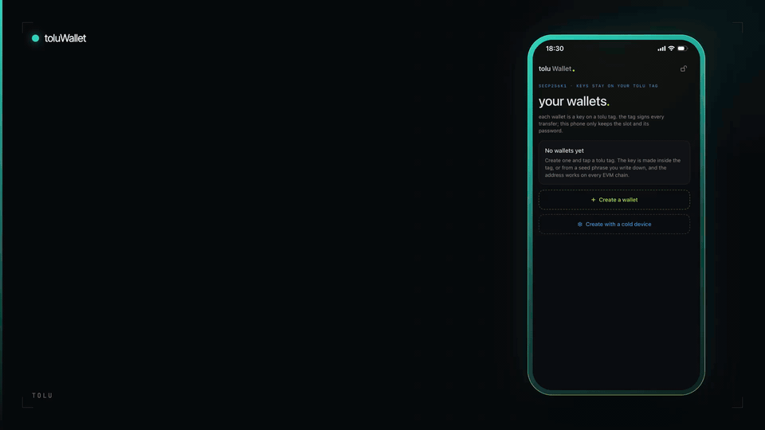

# toluWallet

*Open-source DIY cold crypto wallet. Don't buy the box that guards your keys:
build it, and read every line it runs.*



toluWallet is an EVM wallet whose private key lives inside a
**[toluTag](https://github.com/mwbpNFTechnology/toluTag)**, a passive NFC tag
carrying an NXP SE051 secure element. An iPhone app is the interface: it shows
balances, receives and sends like any wallet, but it never holds the key. The
tag signs every transfer.

For a wallet with a seed-phrase backup that never touches a phone, the
repository also holds **tolu_cold**: an offline ESP32 device you build from
three off-the-shelf modules, which makes the seed phrase and writes its key
straight onto the tag.

| Component | Platform | What it is | Parts |
|---|---|---|---|
| [`toluWallet`](toluWallet) | iOS 26, SwiftUI, CoreNFC | The wallet: balances by chain, receive, send, and three ways to create a key | An iPhone |
| [`tolu_cold`](tolu_cold) | ESP32 / ESP32-S3, Arduino | The offline key-ceremony device: seed phrase on its own screen, key onto the tag | Under $15 |
| [toluTag](https://github.com/mwbpNFTechnology/toluTag) | NXP SE051 over NFC | Where the key lives. A separate, open project: build one or request a dev kit | Under $4 |

The hardware is cheap on purpose: a toluTag can be produced for **under 4 USD**
in components and a tolu_cold for **under 15 USD**, so the whole setup, tag
plus key-ceremony device, comes to under 19 USD in parts.

There is no account, no server of ours and no update channel. The app has no
third-party dependencies; Keccak-256, secp256k1, RLP, transaction encoding,
BIP-39 and BIP-32 are implemented in this repository, in Swift for the app and
in C++ for the device, and tested against the same reference values.

---

## Why I built this

A hardware wallet is a promise: *this box keeps your key away from everything
else.* You cannot check that promise. You are asked to trust the company that
made the box, the firmware inside it that you cannot read, the shop that sold
it, and everyone who handled it before it reached your door.

One of the best-known makers in the business shows how much there is to trust.
None of what follows needed anyone to break the chip inside:

- **2020, the customer list.** Ledger's e-commerce database was stolen and
  later published: about 272,000 names, home addresses and phone numbers, and
  over a million email addresses.
  ([Decrypt](https://decrypt.co/52118/hacked-ledger-database-dumped-on-raidforums))
- **2021, the box in the post.** People on that list began receiving tampered
  Ledger devices by mail, shrink-wrapped, with a letter in the CEO's name
  telling them to switch to the "replacement". The aim was to get them to
  enter their recovery phrase.
  ([BleepingComputer](https://www.bleepingcomputer.com/news/cryptocurrency/criminals-are-mailing-altered-ledger-devices-to-steal-cryptocurrency/))
- **2023, the firmware.** Ledger announced Recover, an optional service in
  which the wallet's firmware sends encrypted shares of the seed phrase to
  three companies. For many owners it was the first time it was clear that a
  firmware update can make the device send key material out at all.
  ([The Block](https://www.theblock.co/post/230992/ledger-defends-crypto-wallet-recovery-tool))
- **2023, the software around it.** A phished former employee's account was
  used to publish a malicious version of Ledger's Connect Kit library. For a
  few hours the apps that loaded it carried a wallet drainer, and about
  $600,000 was taken from their users. The hardware itself was not breached.
  ([Ledger's incident report](https://www.ledger.com/blog/security-incident-report))

This is not about one company; it is simply the best-documented one. The lesson
is general. A sealed product from a known brand is a target: for whoever can
get between the factory and you, and for whoever can change what it runs. And
you, the owner, have no way to look inside.

So I stopped looking for a wallet I could trust and built one that asks for as
little trust as possible:

- **Nothing to intercept.** There is no "wallet" in a box. The device is a
  generic ESP32 board, an NFC module and a display, bought wherever you like
  for under 15 USD. Nobody upstream knows they will ever hold a key.
- **Nothing you can't read.** The app, the firmware and all of the cryptography
  are in this repository. You compile and flash them yourself.
- **Nothing in between.** No account, no vendor server, no forced updates. The
  app talks to public blockchain nodes; the device talks to nobody.
- **The key stays in a secure element.** It is generated in, or written once
  into, a toluTag and cannot be read back out. Every signature is made by the
  chip, behind a password it enforces itself.

What you are still trusting is listed, plainly, [further down](#what-you-still-trust).

---

## A wallet on a toluTag

A [toluTag](https://github.com/mwbpNFTechnology/toluTag) is an open NFC tag
around an SE051 secure element that can hold a secp256k1 key and sign with it.
toluWallet is the iOS interface built on top: it turns that tag into a wallet
you use like any other.

**Portfolio**

- Balances for every chain, sorted by value in US dollars; chains with nothing
  on them are greyed out.
- Open a chain to see its tokens (ERC-20), NFT collections (ERC-721 and
  ERC-1155, view only) and the transaction history.
- Nine networks out of the box: Ethereum, Optimism, BNB Smart Chain, Polygon,
  Base, Arbitrum One, Avalanche C-Chain, and the Sepolia and Base Sepolia
  testnets. One address works on all of them.

**Receive**

- The wallet's address as text and as a QR code.

**Send**

- The native coin or any ERC-20 token, with the fee estimated before you
  confirm (EIP-1559 where the chain supports it, including the L1 data fee on
  OP-stack chains).
- The app builds the transaction, you tap the tag, the chip signs it, and the
  app broadcasts it and waits for it to settle.

**Locked by Face ID**

- The phone stores only where each wallet lives on the tag (two object ids)
  and its password, in the Keychain behind Face ID. It locks itself after a
  minute in the background.

### How a transfer is signed

1. The app reads the nonce and fees from a public node and builds the
   transaction.
2. You hold the tag to the phone. The app opens a session on the chip with the
   wallet's password and asks it to sign the transaction's hash.
3. The chip returns an ECDSA signature. The app works out the recovery id by
   checking which candidate recovers the tag's own public key, then broadcasts.

The key is bound on the chip to a **password object**: outside a session opened
with that password the chip will not sign, and after **5 wrong attempts** it
locks the key for good.

### Where the data comes from

The app talks directly to public JSON-RPC endpoints for balances, fees and
broadcasting, to [Blockscout](https://www.blockscout.com) for token lists, NFTs
and history, and to [DefiLlama](https://defillama.com) for prices. Full token,
NFT and history discovery currently works on Ethereum, Optimism, Sepolia and
Base Sepolia; the other networks show the native coin and a built-in list of
major tokens (USDC, USDT, DAI, WETH).

---

## Creating a wallet

There are three ways to put a key on the tag. They differ in where the key is
born and whether a backup exists.

| | Made inside the tag | From a seed phrase | With tolu_cold |
|---|---|---|---|
| Where the key is born | In the secure element | On the phone | On the offline device |
| Backup | None, by design | 12 words on paper | 12 words on paper |
| Does the key ever touch the phone | Never | For a moment | Never |
| Lose the tag | The wallet is gone | Restore from the words | Restore from the words |
| What you need | Phone and tag | Phone and tag | Phone, tag and a tolu_cold |

A fourth option, **Already on the tag**, imports a wallet created earlier: it
only reads the tag and writes nothing.

### Made inside the tag

The secure element generates the key pair itself and the private key never
exists anywhere else, not even for an instant. Nothing can copy it, which is
the strongest guarantee here, and also means nothing can back it up: lose the
tag, forget the password, or enter it wrong five times, and whatever the wallet
holds is gone.

Two taps: one creates the key, one opens a password session and reads the
address back.

### From a seed phrase

For a wallet you can recover.

1. **Tap.** The app checks the slots are free and takes a random number
   generated **inside the tag's secure element**. It is hashed together with a
   second one from the phone, so neither source alone decides the result.
2. **Write the 12 words down.** They follow BIP-39, and the key is the standard
   first Ethereum account (`m/44'/60'/0'/0/0`), so the phrase restores this
   exact address in MetaMask, a Ledger or any other standard wallet.
3. **Confirm three of them**, picked at random.
4. **Tap twice more.** The key is written to the tag, then read back and
   compared with the one from your words.

The words are hidden while the screen is being recorded or mirrored and in the
app switcher, erased after ten minutes, and forgotten by the phone as soon as
the tag confirms the write.

The trade-off is in the table: for those few minutes the words and the key
exist on the phone. If that is not acceptable, use the device below.

---

## tolu_cold: the seed phrase never touches the phone

tolu_cold is an isolated ESP32-based device that makes the seed phrase and
turns the tag into a true cold wallet. The phone hands it only the two slot
numbers and the password; everything secret happens on the device and the tag.
It is built from under 15 USD of components.


*The phrase in the photo belongs to a throwaway demo wallet. A seed phrase that
has been photographed is public: never use one that appears in a picture,
including this one.*

```
toluWallet (iPhone) ──NFC──▶ tolu_cold (ESP32) ◀──NFC──▶ toluTag (SE051)
   slots + password           makes the words            random numbers out,
                              and the key                key + password in
         ▲                           │
         └────── QR: address ◀───────┘
```

| # | What happens |
|---|---|
| 1 | In the app choose **Create with a cold device**, enter the details, and hold the phone to the device. |
| 2 | Hold the tag on the device. It takes a random number from the tag's secure element, mixes it with its own, and shows 12 words on its screen. |
| 3 | Write the words down and confirm three of them with the device's one button. |
| 4 | Hold the tag on the device again. It writes the key, then reads it back to prove it. |
| 5 | The device shows the wallet's address as a QR code. Scan it in the app and tap the tag: the wallet is saved only if the tag's address matches. |

What makes it cold:

- **Offline.** The firmware never switches on Wi-Fi or Bluetooth and has no
  serial protocol. Its only link to the outside is NFC at a few centimetres.
- **It keeps nothing.** There is no storage. The words and the key live in
  memory for the minutes the ceremony takes and are overwritten when it ends,
  when it is cancelled, or after ten idle minutes.
- **The phone learns only the address.** It never sees the words or the key.
- **No clock, no counter in the seed.** The phrase comes from the secure
  element's hardware random generator mixed with the ESP32's, not from anything
  that can be guessed by trying values.
- **You built it.** An ESP32 board, a PN532 NFC module, a small display and a
  button: parts from any electronics shop, wired on a breadboard, running
  firmware you compiled.

Everything needed to build one is in [`tolu_cold`](tolu_cold):

- [`README.md`](tolu_cold/README.md): wiring, build and flash, configuration,
  the security model and the protocol
- [`BOM.md`](tolu_cold/BOM.md): the parts list
- [`test/`](tolu_cold/test): tests that run on a computer, no hardware needed

---

## What you still trust

An honest list, because "trustless" is never completely true.

- **The secure element.** NXP's SE051 is a closed chip. You trust it to
  generate good random numbers and to never give up a key, exactly as every
  hardware wallet trusts the chip it is built on.
- **The phone, for what you sign.** The tag has no screen. A compromised phone
  cannot copy the key, but it could show one transfer and ask the tag to sign
  another. It can only do that while the tag is physically on the phone.
- **The air between them.** NFC sessions with the tag are not encrypted. When a
  key is written to the tag (from the phone or from tolu_cold), someone
  recording radio within a few centimetres could capture it, so do that step
  somewhere private. The password crosses the same way each time you sign; on
  its own it is useless without the tag.
- **The nodes, for what you see.** Public RPC and indexer services can show a
  wrong balance. They cannot move funds.
- **Your own build.** The compiler, the libraries for the display and the NFC
  module, and the board you bought.
- **The paper.** Whoever holds the 12 words holds the wallet, with no tag and
  no password needed.

---

## Repository layout

```
toluWallet/
├── docs/                           # images used in this README
├── toluWallet/                     # iOS app (Xcode project)
│   ├── toluWallet/
│   │   ├── App/                    # root view, locking
│   │   ├── Core/SE05x/             # applet constants, TLV, object ids, key-write payload
│   │   ├── Core/NFC/               # CoreNFC runner, tag read / sign / write, link to tolu_cold
│   │   ├── Core/Crypto/            # Keccak256, secp256k1, BigUInt, RLP, transactions, BIP-39, BIP-32
│   │   ├── Core/Chain/             # networks, JSON-RPC, ERC-20, Blockscout, prices
│   │   ├── Features/               # Lock, Wallets, CreateWallet, ColdWallet, WalletDetail,
│   │   │                           # ChainDetail, Receive, Transfer (View + @Observable model)
│   │   ├── Components/             # design-system views
│   │   ├── Models/                 # wallet record, holdings, activity
│   │   ├── Services/               # WalletStore (Keychain + Face ID), portfolio
│   │   ├── Navigation/             # AppRoute, Router
│   │   └── Theme/                  # palette, typography
│   └── toluWalletTests/            # unit tests
└── tolu_cold/                      # ESP32 firmware (Arduino sketch)
    ├── tolu_cold.ino               # the flow
    ├── config.h                    # pins and options
    ├── cold_*.h                    # crypto, NFC, card commands, display, button
    ├── test/                       # tests that run on a computer
    ├── BOM.md                      # bill of materials
    └── README.md
```

---

## iOS app

### Requirements

- Xcode 26+, iOS 26.5 target, Swift 5
- A physical iPhone with NFC (CoreNFC does not work in the Simulator)
- A paid Apple Developer account: the app needs the **NFC Tag Reading**
  capability and an entitlement whitelisting the applets it selects
- A toluTag

### Entitlements

`Info.plist` declares the two applets the app is allowed to select: the SE05x
applet on the tag, and tolu_cold's own id (`F0` + "toluCOLD") for handing a
setup to the device.

```xml
<key>com.apple.developer.nfc.readersession.iso7816.select-identifiers</key>
<array>
    <string>A0000003965453000000010300000000</string>
    <string>F0746F6C75434F4C44</string>
</array>
```

`toluWallet.entitlements` carries `com.apple.developer.nfc.readersession.formats`
with `TAG`, and the provisioning profile must include the NFC capability.

### Build

```bash
open toluWallet/toluWallet.xcodeproj
```

Set your own team and bundle id (currently `io.mwbp.toluWallet`), then run on a
device.

### Tests

The unit tests need no tag. They check transaction encoding and signatures
against vectors from the [ethers](https://ethers.org) library, the seed phrase
path (word list, phrase, key and address) against the standard BIP-39 vectors,
and the bytes the app shares with the tolu_cold firmware against the same
values the firmware's own tests use.

---

## tolu_cold device

```bash
cd tolu_cold
./test/run.sh                                         # the tests, on your computer
arduino-cli compile --fqbn esp32:esp32:esp32s3 .      # or open tolu_cold.ino in the Arduino IDE
```

Wiring, libraries and flashing are in [`tolu_cold/README.md`](tolu_cold/README.md).

---

## Notes

- **Object ids** are 4 bytes, entered as 8 hex characters. A wallet uses two
  slots on the tag: one for the key and one for the password that guards it.
  One tag can hold several wallets in different slots.
- **Five password attempts.** New wallets are created with a limit of 5 wrong
  passwords, after which the chip locks the key permanently. With a seed phrase
  the words are then the way back; without one there is none.
- **Keys cannot be deleted.** Wallet keys are written without the delete
  permission. Removing a wallet in the app only forgets it on that phone.
- **One address, every chain.** The same key gives the same address on every
  EVM network.
- **A wallet can be added on another phone** with *Already on the tag*, using
  its two object ids and its password.

## Status

A working prototype under active development. **It has not been audited.** Do
not keep more in it than you are prepared to lose.

- Creating a wallet inside the tag, reading it back and showing balances have
  been run on a real tag.
- Transaction encoding and signature handling are checked against reference
  vectors. The seed phrase path is checked against the ethers library: 46
  wallets in the firmware's tests, and the standard BIP-39 vectors in the
  app's.
- tolu_cold has run a full ceremony on real hardware (the photo above): random
  numbers from the tag, the words, the check, the key written to the tag and
  read back, and the address QR. What is still to be confirmed on hardware is
  listed in [`tolu_cold/README.md`](tolu_cold/README.md#status).
- The seed-phrase option in the app passes its tests but has not yet been
  proven end to end on a tag.

## License

[MIT](LICENSE).

---

<sub>toluWallet is built on [toluTag](https://github.com/mwbpNFTechnology/toluTag), by [mwbp.io](https://x.com/mwbp_io).</sub>
