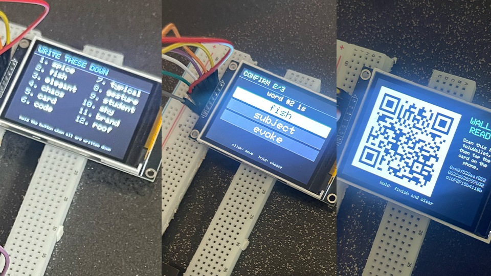

# toluCold

An offline ESP32 device that creates a wallet key for a **tolu card** — a
[toluTag](https://github.com/mwbpNFTechnology/toluTag), an NXP SE051 secure
element over NFC — without the key ever touching a phone or a network. It is
the cold half of [toluWallet](../README.md), and its parts come to under 15 USD.



*The phrase in the photo belongs to a throwaway demo wallet. A seed phrase that
has been photographed is public: never use one that appears in a picture.*

**The seed phrase comes from a random number generated inside the secure
element.** The device asks the card's own hardware random generator for it,
mixes it with a second random number from the ESP32, turns the result into 12
words, shows them once, and writes the key they stand for straight onto the
card — bound to your iPhone's Secure Enclave key, so that only that phone,
after Face ID, can ever use it. The phone only ever learns the wallet's
address, and sends the device nothing secret.

```
toluWallet (iPhone) ──NFC──▶ toluCold (ESP32) ◀──NFC──▶ tolu card (SE051)
   slots + phone key          makes the words            random numbers out,
                              and the key                key + phone key in
         ▲                           │
         └────── QR: address ◀───────┘
```

> **Status: prototype.** It has run a full ceremony on real hardware and its
> logic is covered by tests that run on a computer, but it has not been audited
> and parts of it are [not yet confirmed on hardware](#status). Do not put more
> in a wallet made with it than you are prepared to lose.

## Contents

- [How it works](#how-it-works)
- [Where the seed phrase comes from](#where-the-seed-phrase-comes-from)
- [Hardware](#hardware)
- [Build and flash](#build-and-flash)
- [Configuration](#configuration)
- [Using it safely](#using-it-safely)
- [Security model](#security-model)
- [Protocol](#protocol)
- [Source layout](#source-layout)
- [Tests](#tests)
- [Status](#status)

## How it works

| # | Where | What happens |
|---|---|---|
| 1 | phone → device | In toluWallet choose **Create with a cold device**, enter the label and object ids, and hold the phone to the reader. The phone sends the slots and its own public key. |
| 2 | card → device | Hold the card on the reader. The device notes which card it is, checks both slots are usable, takes 32 random bytes from the card's secure element, mixes them with 32 of its own, and turns the result into 12 words. |
| 3 | device | Write the words down. Hold the button, then confirm three of them: **click** moves, **hold** selects. A wrong answer sends you back to the words. |
| 4 | device → card | Hold the same card on the reader again. The device writes the phone's public key as an ECKey authentication object, then the wallet key with a policy that lets only that phone's session use it. The key travels encrypted, inside a session the device opens with a temporary key of its own ([how](#how-the-key-reaches-the-card)). |
| 5 | device → phone | The screen shows the address as a QR. Scan it in the app, confirm with Face ID and tap the card: the app reads the key in its own encrypted session and saves the wallet only if the card's address equals the QR's. |

The words follow BIP-39 and the key is `m/44'/60'/0'/0/0`, so the phrase
restores this exact address in any standard Ethereum wallet.

### Cancelling

Until the wallet is finished, the ceremony can be called off:

- **From the app** — **Cancel**, then tap the phone on the device. The device
  erases everything it holds, says whether anything had already reached the
  card, and goes back to its start screen. Sending the details again does the
  same and starts over with them.
- **On the device** — hold the button while it is waiting for the card.
- **By leaving it** — after ten minutes with no button press it erases itself.

Once the QR is on screen there is nothing left to cancel: the key is on the
card, and a hold clears the screen.

## Where the seed phrase comes from

From a random number generated **inside the secure element**. The card's SE051
has its own hardware generator: a pseudo-random generator compliant with AIS20
class DRG.4 and NIST SP 800-90A, seeded by a true random source in the chip
compliant with AIS31 class PTG.2 (NXP's SE051 data sheet, section 3.2.7). The
device reads 32 bytes from it with the applet's `GetRandom` command.

There is no clock, no counter and no serial number in the recipe — nothing an
attacker could find by trying values, which is how wallets seeded from a
timestamp have been emptied.

The card's number is then hashed together with a second one from the ESP32's
hardware generator:

```
entropy = SHA-256( "tolu entropy v1" | 32 bytes from the secure element | 32 bytes from the ESP32 )
          cut to 16 bytes for 12 words, or kept at 32 for 24 words
```

The second source is there for two reasons:

- **Either generator alone is enough.** Hashing can only add: the phrase is at
  least as hard to guess as the better of the two inputs, so a weakness in one
  is covered by the other.
- **The card's bytes cross the air unencrypted.** Someone who captured them
  still has nothing, because the ESP32's half never leaves the device.

With no radio running the ESP32's generator has no noise feeding it, so
`setup()` switches on its internal entropy source
(`bootloader_random_enable()`).

A card whose random bytes are all the same is refused outright. The mix would
still be sound, but such a card could not be trusted to sign: every signature
needs a fresh random number from the same generator.

## Hardware

- an **ESP32-S3** board, or a classic **ESP32 Dev Module**
- a **PN532** NFC module, set to **SPI**
- an **SPI TFT**: ILI9341 240×320 (recommended — 12 words fit on one page), or
  ST7735 128×160 / 128×128
- one **push button** — or none: the board's BOOT button works
- a **tolu card** (NXP SE051 with the IoT applet)

The full parts list, with quantities, wire counts and tools, is in
[BOM.md](BOM.md).

### Wiring

The PN532 and the display each get an SPI bus of their own. They run at
different speeds and bit orders, and NFC reads get garbled if they share
clock or data wires.

| Module pin | ESP32-S3 | ESP32 Dev Module |
|---|---|---|
| PN532 SCK | GPIO 40 | GPIO 18 |
| PN532 MISO | GPIO 41 | GPIO 19 |
| PN532 MOSI | GPIO 42 | GPIO 23 |
| PN532 SS | GPIO 39 | GPIO 5 |
| TFT SCK | GPIO 21 | GPIO 14 |
| TFT SDA / MOSI | GPIO 47 | GPIO 13 |
| TFT CS | GPIO 14 | GPIO 32 |
| TFT DC / A0 | GPIO 2 | GPIO 27 |
| TFT RESET | GPIO 1 | GPIO 26 |
| TFT LED (backlight) | 3V3 | 3V3 |
| Button | GPIO 0 ↔ GND | GPIO 0 ↔ GND |
| VCC (both modules) | 3V3 | 3V3 |
| GND (both modules) | GND | GND |

- **PN532 mode switches** must select SPI. On the common red V3 module that is
  switch 1 off, switch 2 on; check the table printed on yours. If it is wrong
  the screen says "PN532 not found".
- **3.3 V only.** The ESP32's pins are 3.3 V logic.
- **The display's MISO pin stays unconnected.**
- **Button:** GPIO 0 is the BOOT button already on the board, so the first test
  needs no button at all. For your own, wire it between any free pin and GND —
  no resistor, the internal pull-up is used — and set `BTN_PIN`. A touch module
  that drives its output high needs `BTN_ACTIVE_LEVEL HIGH`.

The ESP32-S3 pins are chosen for an N16R8 camera board and avoid the camera
(4–18), the octal flash and PSRAM (26–37), USB (19/20), UART0 (43/44) and the
RGB LED (48). Change them in `config.h` for another board.

## Build and flash

**Libraries:**

- `PN532` and `PN532_SPI` from [Seeed-Studio/PN532](https://github.com/Seeed-Studio/PN532) —
  copy those two folders into your Arduino `libraries` folder
- `Adafruit GFX Library` (Library Manager)
- `Adafruit ILI9341`, or `Adafruit ST7735 and ST7789 Library` for the small
  screens (Library Manager)

The QR generator is part of the ESP32 Arduino core (developed against 3.3.7).

**Arduino IDE:** open `tolu_cold.ino`, choose **ESP32S3 Dev Module** (or
**ESP32 Dev Module**), and upload. Pins follow the board you select.

> An ESP32-S3 plugged in through its native USB port is sometimes
> auto-detected as **ESP32 Family Device**. That entry has no partition
> table, and the build stops with
> `…/partitions/{build.partitions}.csv: No such file or directory`.
> Pick **ESP32S3 Dev Module** by hand.

**Command line:**

```bash
arduino-cli compile --fqbn esp32:esp32:esp32s3 .
arduino-cli upload  --fqbn esp32:esp32:esp32s3 --port <port> .
```

For progress messages on the S3's native USB port, enable **USB CDC On Boot**.
The serial output never contains the words or the key.

## Configuration

Everything is in `config.h`.

| Setting | Default | Meaning |
|---|---|---|
| `COLD_MNEMONIC_WORDS` | 12 | 12 words (128 bits) or 24 (256 bits) |
| `COLD_QUIZ_WORDS` | 3 | words to confirm |
| `COLD_TEMP_KEY_ID` | `7FFEC01D` | the card slot the device borrows for its temporary key during the write; the app's slots may not be this one |
| `BTN_PIN`, `BTN_ACTIVE_LEVEL` | 0, `LOW` | the button |
| `BTN_HOLD_MS` | 800 | how long a press counts as "select" |
| `IDLE_WIPE_MS` | 10 min | unattended time before the words are erased |
| `PHONE_LISTEN_MS` | 300 | while waiting for the card, how long the device listens for the phone between looks for the card, so the app can cancel; 0 = cancel with the button only |
| `TFT_ILI9341` / `TFT_ST7735_18` / `TFT_ST7735_144` | ILI9341 | display model — exactly one |
| `TFT_LANDSCAPE_MADCTL` | `0x88` | scan direction, if the picture is flipped or mirrored |

## Using it safely

- **Power it from a charger or a power bank, not a computer.** Nothing in the
  sketch talks over USB, but a wall plug removes the question.
- **Nobody else should see the screen** while the words are on it, and no
  camera should either.
- **The words are the wallet.** Anyone who has them can move everything; if
  the card is lost or locked, they are the only way to get it back.
- **Flash only firmware you built from this source.** A changed sketch could
  show one phrase and write another key.

## Security model

**What the device keeps:** nothing. There is no storage in the sketch. The
words and the private key live in RAM from step 2 to step 4 and are overwritten
as soon as the card is written, on any failure that starts over, and after ten
minutes with no button press. No Wi-Fi, no Bluetooth, no serial protocol.

**What crosses each link:**

| Link | Carries | In the clear? |
|---|---|---|
| phone → device | object ids, the phone's public key | yes — nothing in it is secret |
| card → device | the secure element's 32 random bytes | yes — useless without the device's half |
| device → card | the phone's public key; a temporary public key | yes — nothing in them is secret |
| device → card | the **private key** | **no** — inside an ECKey session the device opens for the write |
| device → phone | address (QR) | public anyway |
| phone → card, every later tap | signatures and hashes | **no** — an ECKey session, encrypted and authenticated |

**What it protects against:** a compromised phone or computer learning the key
(they never see it), a guessable seed, a weak generator on either side — and
anyone who gets hold of the card: its key works only inside a session opened
with your iPhone's Secure Enclave key, which needs Face ID. The device itself
can write the key but never use it.

**What it does not protect against:**

- someone within NFC range cancelling or restarting a ceremony — a nuisance,
  not a leak: either one makes the device erase what it holds;
- a camera or a person seeing the screen;
- modified firmware, or an attacker with the device in hand while the words are
  in memory;
- timing or power analysis of the device — the curve arithmetic is not
  constant-time; every key it works on is used once, offline;
- whoever finds the paper.

On the card, the key is written with a policy that names the phone's key: in a
session opened with it (NXP's *ECKey session*: the phone signs a fresh P-256
key with its Secure Enclave key, both sides derive AES keys by ECDH, and every
command after that is encrypted and MACed) it may sign, verify and hand out its
public key. Nobody else may do anything with it, and the policy grants no right
to overwrite or delete it. The phone's key itself is written with the default
policy for authentication objects: anyone may read it, nobody may change or
delete it, and there is no attempt counter — a signature can't be guessed.

### How the key reaches the card

The card encrypts only inside a session, and opens one only for someone who
proves they hold the private half of an authentication key stored on it. Your
iPhone's key can't do that here — it never leaves the iPhone — so for the
write the device brings a key of its own ([`cold_session.h`](cold_session.h)):

1. It makes a fresh P-256 key and writes the public half to the card as an
   ECKey authentication object, in slot `COLD_TEMP_KEY_ID`. Its policy gives
   the default session — anybody — the right to delete it, and nothing else.
2. It opens an ECKey session with it, exactly as the app does with the
   phone's key: it signs a one-time P-256 key with the temporary key, the card
   checks the signature and answers a random challenge, both sides derive AES
   keys by ECDH with the card's own session key, and the card's receipt proves
   it derived the same ones.
3. It writes the wallet key inside that session: encrypted with AES-CBC and
   MACed with AES-CMAC, with the same policy as always — only the phone's
   session may use it.
4. It deletes the temporary key from the card and wipes both keys from its
   memory. The session it opened ends with the card's power, a moment later.

No key on the card names the temporary key in its policy, so its session can't
read, use, change or delete any of them. All it could do is create objects,
which anyone can, and it is gone at the end of the write. If a write stops
half-way and leaves it behind, the next write deletes it first.

The two P-256 keys come from SHA-256 over 32 fresh bytes of the ESP32's
generator and the wallet key itself: new every time, and secret even if the
generator could be predicted — working them out from what crosses the air
would take the very key they protect. The signature's nonce follows RFC 6979.

Someone recording step 4 sees the phone's public key, the temporary public
key, a one-time public key and its signature, the card's challenge and
receipt, and ciphertext. None of it gives the key away, and none of it can be
replayed: a new session has a new challenge, and its keys need the one-time
private key, which never left the device and no longer exists.

## Protocol

**Phone → device.** An iPhone cannot act as a card towards another reader, so
the PN532 plays one (target mode) and the phone, already an ISO 7816 reader for
the tolu card, writes to it:

```
SELECT F0746F6C75434F4C44                 → 9000        AID: F0 + "toluCOLD"
80 20 00 00 <Lc> <setup>                  → 9000        start a wallet
80 21 00 00                               → 9000        cancel

setup = 02 | key object id (4) | phone key object id (4) | phone key (65)
```

The phone key is the iPhone's P-256 public key, `04 || X || Y`.

A setup starts the ceremony — over again, if one was running. A cancel ends the
one in progress, and is accepted (and changes nothing) when there is none.
`6A80` refuses a setup: an unknown version (the first firmware's password
setup, version `01`, included), the same id twice, an id of zero, in NXP's
reserved `7FFFxxxx` range or equal to `COLD_TEMP_KEY_ID`, or a phone key that
is not an uncompressed point.
`6A82` answers a SELECT for any other AID.

The device listens for the phone on its start screen, on every screen that
waits for the button, and — in short turns, between looks for the card —
while it waits for the card. It does not listen once the wallet is finished:
the phone's next tap is meant for the card, which may still be lying on the
reader.

**Device → card.** APDUs to the SE05x IoT applet
(`A0000003965453000000010300000000`), all plain but the key's:

| Step | Command |
|---|---|
| which card | `ReadObject` of the unique id (`7FFF0206`); a retry must be on the same card |
| are the slots usable | `CheckObjectExists`, and `ReadObject` of the phone key slot: free, or exactly this phone's key |
| random numbers | `GetRandom` (32 bytes) |
| the curves | `CreateECCurve`, `SetECCurveParam` ×5, for secp256k1 and for NIST P-256 |
| the phone key | `WriteECKey` as an authentication object (`80 41 21 00`): the public key on P-256, default policy, no attempt limit |
| a temporary key | `CheckObjectExists` of `COLD_TEMP_KEY_ID`, and `DeleteSecureObject` of what an earlier try left there; `WriteECKey` as an authentication object (`80 41 21 00`): a new P-256 public key, policy `08 00000000 00040000` (the default session may delete it) |
| the session | `ReadObject` of the card's session key (`7FFF0201`); `CreateSession` for the temporary key; `ECKeySessionInternalAuthenticate` (`84 88 00 00`) in `ProcessSessionCmd` |
| the key | `WriteECKey` (key pair) carrying the private and public key, with a policy: sign, verify, read — for the phone key only. Sent protected (`84 01 61 00`) in `ProcessSessionCmd` |
| clean-up | `DeleteSecureObject` of the temporary key |
| proof | `CheckObjectExists`. The device can't read the key back: the phone does, in its own session, in step 5 |

## Source layout

A flat Arduino sketch. Each header is one module, and every function in them is
`static inline`, so the whole firmware is a single translation unit — and so
the modules without hardware in them also compile on a computer, unchanged, for
the tests.

| File | What it is |
|---|---|
| `tolu_cold.ino` | the flow: one function per step, and the main loop |
| `config.h` | pins, button, timing, options |
| `cold_state.h` | the states, and everything secret the device holds |
| `cold_util.h` | wiping memory, comparing MACs; big-endian integers |
| `cold_sha2.h` | SHA-256, SHA-512, HMAC-SHA256, HMAC-SHA512, PBKDF2 |
| `cold_keccak.h` | Keccak-256 and Ethereum addresses |
| `cold_u256.h` | 256-bit integers, for both curves |
| `cold_secp256k1.h` | the wallet's curve: field arithmetic and private → public key |
| `cold_p256.h` | NIST P-256 for the encrypted write: keys, ECDH, ECDSA (RFC 6979) |
| `cold_aes.h` | AES-128, CBC and AES-CMAC |
| `cold_bip39.h`, `cold_bip39_words.h` | entropy → seed phrase → seed |
| `cold_bip32.h` | seed → the key at `m/44'/60'/0'/0/0` |
| `cold_entropy.h` | the two random sources, hashed into one |
| `cold_pn532.h` | the PN532 and the transport its two roles share |
| `cold_target.h` | PN532 as a card: the phone's tap |
| `cold_reader.h` | PN532 as a reader: APDUs to the card |
| `cold_se05x.h` | the SE05x commands |
| `cold_session.h` | the encrypted write: the temporary key, the ECKey session, secure messaging |
| `cold_display.h` | the screens |
| `cold_button.h` | one button: click and hold |
| `test/` | tests that run on a computer |
| `BOM.md` | the parts list |

## Tests

```bash
./test/run.sh
```

It needs only a C++17 compiler. It builds the firmware's own headers with
warnings as errors and with the address and undefined-behaviour sanitizers,
then runs three programs:

- **`test_crypto`** — phrase, seed, private key, public key and address for 46
  wallets (12 and 24 words) against the [ethers](https://ethers.org) library;
  SHA-256, SHA-512, HMAC-SHA512 and Keccak-256 around every block boundary
  against Node's crypto module; field arithmetic at the edges of the modulus;
  the word list against the published BIP-39 file; the entropy mix against an
  independent SHA-256.
- **`test_card`** — every command the device sends, byte for byte, against a
  pretend SE05x that refuses what a real card refuses (a slot written twice, a
  key on a curve it was never told, any read of the wallet key outside the
  phone's session, a delete its policy does not allow) and runs ECKey sessions
  as a card does — it checks the signature, derives the keys, checks every
  MAC and decrypts. The encrypted write is followed end to end: the private
  key appears in no APDU in the clear, it lands bound to the phone's key, and
  the temporary key is gone afterwards — also when a leftover was in the way,
  the slot can't be freed, the receipt or an answer's MAC is wrong, or the
  card refuses the session. Then the phone's tap against a pretend PN532, and
  the transport's error paths.
- **`test_session`** — AES-128, CBC, AES-CMAC, HMAC-SHA256, P-256 keys and
  ECDH against Node's crypto module; ECDSA against RFC 6979's own signatures,
  and the verifier the pretend card uses against Node's; the session keys,
  protected commands and opened answers against the values the toluWallet
  app's tests pin — so the device and the phone produce the same bytes.

The reference values are in `test/vectors.txt` and `test/session_vectors.txt`;
`test/make_vectors.js` and `test/make_session_vectors.js` regenerate them.

toluWallet can also make a seed-phrase wallet on the phone itself. Its unit
tests hold it to the same entropy vector, the same `WriteECKey` bytes, the
same phone-key bytes and the same secure-messaging bytes as this firmware.

## Status

Compiles for `esp32:esp32:esp32s3` and `esp32:esp32:esp32` with no warnings
from the sketch, and passes the tests above.

It has run a full ceremony on real hardware, with the key written in the
clear: random numbers from the card, the seed phrase, the three-word check,
the key written to the card and read back, and the address QR — the three
screens in the photo at the top.

Still to be confirmed on hardware:

1. the encrypted write. The ECKey session itself is proven — the app opens it
   on real tags with the same bytes — but not yet with a temporary key: that
   the card accepts it with its delete-only policy, opens a session for it,
   takes the key inside it, and lets the default session delete it. If a step
   fails, the screen names it and shows the card's status word;
2. the phone key, as the device writes it, and the app reading back the key
   the device wrote (step 5). The card's side is proven: the app writes the
   same bytes on real tags;
3. cancelling from the phone while the device waits for the card, for which
   the PN532 has to alternate cleanly between looking for the card and
   listening for the phone. If the card stops being found, set
   `PHONE_LISTEN_MS` to 0.

If a card step fails, the screen shows the card's status word (for example
`6985`), which says which command it was.
