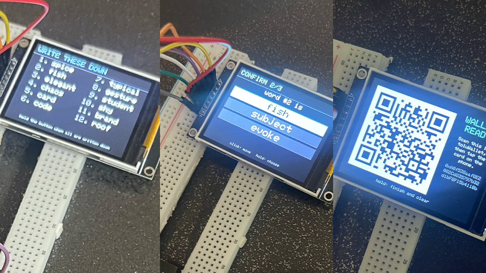

# toluCold

An offline ESP32 device that creates a wallet key for a **tolu card** — a
[toluTag](https://github.com/mwbpNFTechnology/toluTag), an NXP SE051 secure
element over NFC — without the key ever touching a phone or a network. It is
the cold half of [toluWallet](../README.md), and its parts come to under 15 USD.



*The phrase in the photo belongs to a throwaway demo wallet. A seed phrase that
has been photographed is public: never use one that appears in a picture.*

**The seed phrase comes from a random number generated inside the secure
element.** The device asks the card's own hardware random generator for it,
mixes it with a second random number from the ESP32, turns the result into 12
words, shows them once, and writes the key they stand for straight onto the
card. The phone only ever learns the wallet's address.

```
toluWallet (iPhone) ──NFC──▶ toluCold (ESP32) ◀──NFC──▶ tolu card (SE051)
   slots + password           makes the words            random numbers out,
                              and the key                key + password in
         ▲                           │
         └────── QR: address ◀───────┘
```

> **Status: prototype.** It has run a full ceremony on real hardware and its
> logic is covered by tests that run on a computer, but it has not been audited
> and parts of it are [not yet confirmed on hardware](#status). Do not put more
> in a wallet made with it than you are prepared to lose.

## Contents

- [How it works](#how-it-works)
- [Where the seed phrase comes from](#where-the-seed-phrase-comes-from)
- [Hardware](#hardware)
- [Build and flash](#build-and-flash)
- [Configuration](#configuration)
- [Using it safely](#using-it-safely)
- [Security model](#security-model)
- [Protocol](#protocol)
- [Source layout](#source-layout)
- [Tests](#tests)
- [Status](#status)

## How it works

| # | Where | What happens |
|---|---|---|
| 1 | phone → device | In toluWallet choose **Create with a cold device**, enter the label, object ids and password, and hold the phone to the reader. |
| 2 | card → device | Hold the card on the reader. The device checks both slots are free, takes 32 random bytes from the card's secure element, mixes them with 32 of its own, and turns the result into 12 words. |
| 3 | device | Write the words down. Hold the button, then confirm three of them: **click** moves, **hold** selects. A wrong answer sends you back to the words. |
| 4 | device → card | Hold the card on the reader again. The device writes the password object (5 attempts) and the key, then opens a password session and reads the public key back to prove it. |
| 5 | device → phone | The screen shows the address as a QR. Scan it in the app, tap the card on the phone, and the app saves the wallet only if the card's address equals the QR's. |

The words follow BIP-39 and the key is `m/44'/60'/0'/0/0`, so the phrase
restores this exact address in any standard Ethereum wallet.

### Cancelling

Until the wallet is finished, the ceremony can be called off:

- **From the app** — **Cancel**, then tap the phone on the device. The device
  erases everything it holds, says whether anything had already reached the
  card, and goes back to its start screen. Sending the details again does the
  same and starts over with them.
- **On the device** — hold the button while it is waiting for the card.
- **By leaving it** — after ten minutes with no button press it erases itself.

Once the QR is on screen there is nothing left to cancel: the key is on the
card, and a hold clears the screen.

## Where the seed phrase comes from

From a random number generated **inside the secure element**. The card's SE051
has its own hardware generator: a pseudo-random generator compliant with AIS20
class DRG.4 and NIST SP 800-90A, seeded by a true random source in the chip
compliant with AIS31 class PTG.2 (NXP's SE051 data sheet, section 3.2.7). The
device reads 32 bytes from it with the applet's `GetRandom` command.

There is no clock, no counter and no serial number in the recipe — nothing an
attacker could find by trying values, which is how wallets seeded from a
timestamp have been emptied.

The card's number is then hashed together with a second one from the ESP32's
hardware generator:

```
entropy = SHA-256( "tolu entropy v1" | 32 bytes from the secure element | 32 bytes from the ESP32 )
          cut to 16 bytes for 12 words, or kept at 32 for 24 words
```

The second source is there for two reasons:

- **Either generator alone is enough.** Hashing can only add: the phrase is at
  least as hard to guess as the better of the two inputs, so a weakness in one
  is covered by the other.
- **The card's bytes cross the air unencrypted.** Someone who captured them
  still has nothing, because the ESP32's half never leaves the device.

With no radio running the ESP32's generator has no noise feeding it, so
`setup()` switches on its internal entropy source
(`bootloader_random_enable()`).

A card whose random bytes are all the same is refused outright. The mix would
still be sound, but such a card could not be trusted to sign: every signature
needs a fresh random number from the same generator.

## Hardware

- an **ESP32-S3** board, or a classic **ESP32 Dev Module**
- a **PN532** NFC module, set to **SPI**
- an **SPI TFT**: ILI9341 240×320 (recommended — 12 words fit on one page), or
  ST7735 128×160 / 128×128
- one **push button** — or none: the board's BOOT button works
- a **tolu card** (NXP SE051 with the IoT applet)

The full parts list, with quantities, wire counts and tools, is in
[BOM.md](BOM.md).

### Wiring

The PN532 and the display each get an SPI bus of their own. They run at
different speeds and bit orders, and NFC reads get garbled if they share
clock or data wires.

| Module pin | ESP32-S3 | ESP32 Dev Module |
|---|---|---|
| PN532 SCK | GPIO 40 | GPIO 18 |
| PN532 MISO | GPIO 41 | GPIO 19 |
| PN532 MOSI | GPIO 42 | GPIO 23 |
| PN532 SS | GPIO 39 | GPIO 5 |
| TFT SCK | GPIO 21 | GPIO 14 |
| TFT SDA / MOSI | GPIO 47 | GPIO 13 |
| TFT CS | GPIO 14 | GPIO 32 |
| TFT DC / A0 | GPIO 2 | GPIO 27 |
| TFT RESET | GPIO 1 | GPIO 26 |
| TFT LED (backlight) | 3V3 | 3V3 |
| Button | GPIO 0 ↔ GND | GPIO 0 ↔ GND |
| VCC (both modules) | 3V3 | 3V3 |
| GND (both modules) | GND | GND |

- **PN532 mode switches** must select SPI. On the common red V3 module that is
  switch 1 off, switch 2 on; check the table printed on yours. If it is wrong
  the screen says "PN532 not found".
- **3.3 V only.** The ESP32's pins are 3.3 V logic.
- **The display's MISO pin stays unconnected.**
- **Button:** GPIO 0 is the BOOT button already on the board, so the first test
  needs no button at all. For your own, wire it between any free pin and GND —
  no resistor, the internal pull-up is used — and set `BTN_PIN`. A touch module
  that drives its output high needs `BTN_ACTIVE_LEVEL HIGH`.

The ESP32-S3 pins are chosen for an N16R8 camera board and avoid the camera
(4–18), the octal flash and PSRAM (26–37), USB (19/20), UART0 (43/44) and the
RGB LED (48). Change them in `config.h` for another board.

## Build and flash

**Libraries:**

- `PN532` and `PN532_SPI` from [Seeed-Studio/PN532](https://github.com/Seeed-Studio/PN532) —
  copy those two folders into your Arduino `libraries` folder
- `Adafruit GFX Library` (Library Manager)
- `Adafruit ILI9341`, or `Adafruit ST7735 and ST7789 Library` for the small
  screens (Library Manager)

The QR generator is part of the ESP32 Arduino core (developed against 3.3.7).

**Arduino IDE:** open `tolu_cold.ino`, choose **ESP32S3 Dev Module** (or
**ESP32 Dev Module**), and upload. Pins follow the board you select.

> An ESP32-S3 plugged in through its native USB port is sometimes
> auto-detected as **ESP32 Family Device**. That entry has no partition
> table, and the build stops with
> `…/partitions/{build.partitions}.csv: No such file or directory`.
> Pick **ESP32S3 Dev Module** by hand.

**Command line:**

```bash
arduino-cli compile --fqbn esp32:esp32:esp32s3 .
arduino-cli upload  --fqbn esp32:esp32:esp32s3 --port <port> .
```

For progress messages on the S3's native USB port, enable **USB CDC On Boot**.
The serial output never contains the words, the key or the password.

## Configuration

Everything is in `config.h`.

| Setting | Default | Meaning |
|---|---|---|
| `COLD_MNEMONIC_WORDS` | 12 | 12 words (128 bits) or 24 (256 bits) |
| `COLD_MAX_ATTEMPTS` | 5 | wrong passwords before the card locks the key for good |
| `COLD_QUIZ_WORDS` | 3 | words to confirm |
| `BTN_PIN`, `BTN_ACTIVE_LEVEL` | 0, `LOW` | the button |
| `BTN_HOLD_MS` | 800 | how long a press counts as "select" |
| `IDLE_WIPE_MS` | 10 min | unattended time before the words are erased |
| `PHONE_LISTEN_MS` | 300 | while waiting for the card, how long the device listens for the phone between looks for the card, so the app can cancel; 0 = cancel with the button only |
| `TFT_ILI9341` / `TFT_ST7735_18` / `TFT_ST7735_144` | ILI9341 | display model — exactly one |
| `TFT_LANDSCAPE_MADCTL` | `0x88` | scan direction, if the picture is flipped or mirrored |

## Using it safely

- **Power it from a charger or a power bank, not a computer.** Nothing in the
  sketch talks over USB, but a wall plug removes the question.
- **Nobody else should see the screen** while the words are on it, and no
  camera should either.
- **The words are the wallet.** Anyone who has them can move everything; if
  the card is lost or locked, they are the only way to get it back.
- **Flash only firmware you built from this source.** A changed sketch could
  show one phrase and write another key.
- **Do the ceremony somewhere you control.** The card link is not encrypted
  (see below).

## Security model

**What the device keeps:** nothing. There is no storage in the sketch. The
words and the private key live in RAM from step 2 to step 4 and are overwritten
as soon as the card is written, on any failure that starts over, and after ten
minutes with no button press. No Wi-Fi, no Bluetooth, no serial protocol.

**What crosses each link:**

| Link | Carries | In the clear? |
|---|---|---|
| phone → device | object ids, password | yes, over NFC at a few centimetres |
| card → device | the secure element's 32 random bytes | yes — useless without the device's half |
| device → card | password, **private key** | yes, over NFC at a few centimetres |
| device → phone | address (QR) | public anyway |

**What it protects against:** a compromised phone or computer learning the key
(they never see it), a guessable seed, and a weak generator on either side.

**What it does not protect against:**

- someone within NFC range recording the write in step 4 — the session to the
  card is plain, not SCP03;
- someone within NFC range cancelling or restarting a ceremony — a nuisance,
  not a leak: either one makes the device erase what it holds;
- a camera or a person seeing the screen;
- modified firmware, or an attacker with the device in hand while the words are
  in memory;
- timing or power analysis of the device — the curve arithmetic is not
  constant-time; it runs once, offline;
- whoever finds the paper.

On the card, the key is written with a policy that names the password object:
inside a session opened with the password it may sign, verify and hand out its
public key. The policy grants no right to overwrite or delete it.

## Protocol

**Phone → device.** An iPhone cannot act as a card towards another reader, so
the PN532 plays one (target mode) and the phone, already an ISO 7816 reader for
the tolu card, writes to it:

```
SELECT F0746F6C75434F4C44                 → 9000        AID: F0 + "toluCOLD"
80 20 00 00 <Lc> <setup>                  → 9000        start a wallet
80 21 00 00                               → 9000        cancel

setup = 01 | key object id (4) | password object id (4) | n | password (n)
```

A setup starts the ceremony — over again, if one was running. A cancel ends the
one in progress, and is accepted (and changes nothing) when there is none.
`6A80` refuses a setup: an unknown version, the same id twice, an id of zero
or in NXP's reserved `7FFFxxxx` range, or a password outside 4–16 bytes.
`6A82` answers a SELECT for any other AID.

The device listens for the phone on its start screen, on every screen that
waits for the button, and — in short turns, between looks for the card —
while it waits for the card. It does not listen once the wallet is finished:
the phone's next tap is meant for the card, which may still be lying on the
reader.

**Device → card.** Plain APDUs to the SE05x IoT applet
(`A0000003965453000000010300000000`):

| Step | Command |
|---|---|
| is the slot free | `CheckObjectExists` |
| random numbers | `GetRandom` (32 bytes) |
| the curve | `CreateECCurve`, `SetECCurveParam` ×5 for secp256k1 |
| the password | `WriteUserID` with a maximum of 5 attempts |
| the key | `WriteECKey` (key pair) carrying the private and public key, with a policy: sign, verify, read — for the password object only |
| proof | `CreateSession`, `VerifySessionUserID`, then `ReadObject` inside the session |

## Source layout

A flat Arduino sketch. Each header is one module, and every function in them is
`static inline`, so the whole firmware is a single translation unit — and so
the modules without hardware in them also compile on a computer, unchanged, for
the tests.

| File | What it is |
|---|---|
| `tolu_cold.ino` | the flow: one function per step, and the main loop |
| `config.h` | pins, button, timing, options |
| `cold_state.h` | the states, and everything secret the device holds |
| `cold_util.h` | wiping memory; big-endian integers |
| `cold_sha2.h` | SHA-256, SHA-512, HMAC-SHA512, PBKDF2 |
| `cold_keccak.h` | Keccak-256 and Ethereum addresses |
| `cold_secp256k1.h` | the curve: field arithmetic and private → public key |
| `cold_bip39.h`, `cold_bip39_words.h` | entropy → seed phrase → seed |
| `cold_bip32.h` | seed → the key at `m/44'/60'/0'/0/0` |
| `cold_entropy.h` | the two random sources, hashed into one |
| `cold_pn532.h` | the PN532 and the transport its two roles share |
| `cold_target.h` | PN532 as a card: the phone's tap |
| `cold_reader.h` | PN532 as a reader: APDUs to the card |
| `cold_se05x.h` | the SE05x commands |
| `cold_display.h` | the screens |
| `cold_button.h` | one button: click and hold |
| `test/` | tests that run on a computer |
| `BOM.md` | the parts list |

## Tests

```bash
./test/run.sh
```

It needs only a C++17 compiler. It builds the firmware's own headers with
warnings as errors and with the address and undefined-behaviour sanitizers,
then runs two programs:

- **`test_crypto`** — phrase, seed, private key, public key and address for 46
  wallets (12 and 24 words) against the [ethers](https://ethers.org) library;
  SHA-256, SHA-512, HMAC-SHA512 and Keccak-256 around every block boundary
  against Node's crypto module; field arithmetic at the edges of the modulus;
  the word list against the published BIP-39 file; the entropy mix against an
  independent SHA-256.
- **`test_card`** — every command the device sends, byte for byte, against a
  pretend SE05x that refuses what a real card refuses (a slot written twice, a
  read outside a session, a password tried after five wrong ones); the phone's
  tap against a pretend PN532; and the transport's error paths.

The reference values are in `test/vectors.txt`; `test/make_vectors.js`
regenerates them.

toluWallet can also make a seed-phrase wallet on the phone itself. Its unit
tests hold it to the same entropy vector and the same `WriteECKey` bytes as
this firmware.

## Status

Compiles for `esp32:esp32:esp32s3` and `esp32:esp32:esp32` with no warnings
from the sketch, and passes the tests above.

It has run a full ceremony on real hardware: random numbers from the card, the
seed phrase, the three-word check, the key written to the card and read back,
and the address QR — the three screens in the photo at the top.

Two things are still to be confirmed on hardware:

1. the attempt limit on the password object — that a sixth try is refused
   after five wrong passwords;
2. cancelling from the phone while the device waits for the card, for which
   the PN532 has to alternate cleanly between looking for the card and
   listening for the phone. If the card stops being found, set
   `PHONE_LISTEN_MS` to 0.

If a card step fails, the screen shows the card's status word (for example
`6985`), which says which command it was.
